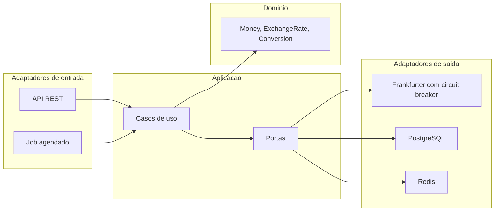
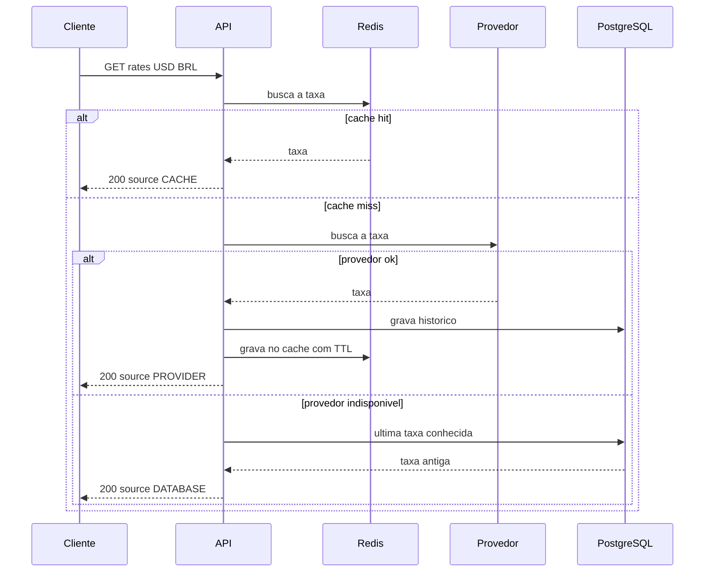

# FX Rate & Currency Exchange API

API REST de câmbio e taxas de moedas, construída com Java 21 e Spring Boot 4 e pensada para casos de uso de fintechs e bancos digitais. Busca taxas de referência em um provedor externo, guarda em cache com Redis, registra o histórico no PostgreSQL, atualiza as taxas automaticamente e converte valores com precisão monetária exata.

## Destaques

- **Arquitetura hexagonal** (portas e adaptadores) com domínio e aplicação em Java puro, sem dependência de framework.
- **Cache-Aside com Redis** e degradação graciosa: se o Redis cair, a API segue funcionando.
- **Resiliência**: circuit breaker no provedor, timeouts explícitos e fallback para a última taxa conhecida no banco.
- **Dinheiro tratado com rigor**: `BigDecimal`, arredondamento bancário por moeda (ISO 4217) e nenhum arredondamento silencioso de entrada.
- **Atualização automática** das taxas com lock distribuído (ShedLock), seguro para várias instâncias.
- **Observabilidade**: métricas Micrometer expostas no Prometheus, incluindo hit ratio do cache e latência do provedor.
- **Testes com infraestrutura real**: PostgreSQL e Redis via Testcontainers, cobertura medida com JaCoCo.

## Arquitetura

### Consulta de taxa (Cache-Aside)

## Tecnologias

Java 21, Spring Boot 4.0.8, PostgreSQL 17 com Flyway, Redis 7.4, Resilience4j, ShedLock, Micrometer e Prometheus, springdoc-openapi, Testcontainers, JUnit 5, AssertJ, JaCoCo, Docker e GitHub Actions.

## Como rodar

Pré-requisito: Docker.

### Tudo em containers

    docker-compose --profile full up --build -d
    curl http://localhost:8080/actuator/health

(No Docker Compose v2, use `docker compose` no lugar de `docker-compose`.)

### Desenvolvimento local

Pré-requisitos: Java 21 e Docker.

    docker-compose up -d
    ./mvnw spring-boot:run

O primeiro comando sobe apenas PostgreSQL e Redis; a aplicação roda na sua máquina.

## API

Documentação interativa (Swagger UI): `http://localhost:8080/swagger-ui.html`
Especificação OpenAPI: `http://localhost:8080/v3/api-docs`

| Método | Caminho | Descrição |
|---|---|---|
| GET | `/api/v1/rates/{base}/{quote}` | Taxa atual e origem do dado (`CACHE`, `PROVIDER` ou `DATABASE`) |
| GET | `/api/v1/rates/{base}/{quote}/history?from=&to=` | Histórico por datas (padrão: 30 dias; máximo: 366) |
| POST | `/api/v1/conversions` | Converte um valor e registra a conversão |
| GET | `/api/v1/conversions/{id}` | Busca uma conversão |
| GET | `/api/v1/conversions?limit=` | Conversões mais recentes (1 a 100) |

Exemplos:

    curl http://localhost:8080/api/v1/rates/USD/BRL

    curl -X POST http://localhost:8080/api/v1/conversions \
      -H "Content-Type: application/json" \
      -d '{"from":"USD","to":"BRL","amount":100.00}'

Valores e taxas são retornados como **strings decimais** (`"525.00"`), para não perder precisão em clientes que leem JSON como `double`. Erros seguem o formato `application/problem+json` (RFC 7807):

    {
      "title": "Requisição inválida",
      "status": 400,
      "detail": "O valor possui mais casas decimais do que a moeda USD permite (2)"
    }

## Observabilidade

Endpoints do Actuator: `/actuator/health`, `/actuator/metrics` e `/actuator/prometheus`.

| Métrica | Descrição |
|---|---|
| `fx.rate.lookups` | Consultas de taxa por origem (`CACHE`, `PROVIDER`, `DATABASE`); base do hit ratio do cache |
| `fx.rate.lookup.failures` | Falhas por motivo (`provider_unavailable`, `not_found`, `invalid_request`) |
| `fx.provider.requests` | Latência e desfecho das chamadas ao provedor |
| `fx.provider.circuit.open` | 1 quando o circuit breaker do provedor está aberto |
| `fx.refresh.runs`, `fx.refresh.duration`, `fx.refresh.rates.inserted` | Execuções do job de atualização |

## Configuração

Todas as propriedades têm valor padrão e podem ser sobrescritas por variável de ambiente.

| Variável | Padrão | Descrição |
|---|---|---|
| `DB_URL`, `DB_USER`, `DB_PASSWORD` | PostgreSQL local | Conexão com o banco |
| `REDIS_HOST`, `REDIS_PORT` | `localhost`, `6379` | Conexão com o Redis |
| `REDIS_TIMEOUT`, `REDIS_CONNECT_TIMEOUT` | `500ms` | Timeouts do Redis |
| `FX_PROVIDER_BASE_URL` | `https://api.frankfurter.dev/v1` | URL base do provedor |
| `FX_PROVIDER_CONNECT_TIMEOUT`, `FX_PROVIDER_READ_TIMEOUT` | `2s`, `5s` | Timeouts do provedor |
| `FX_PROVIDER_CB_FAILURE_RATE` | `50` | Percentual de falhas que abre o circuito |
| `FX_PROVIDER_CB_WINDOW`, `FX_PROVIDER_CB_MIN_CALLS` | `10`, `5` | Janela e mínimo de chamadas do circuito |
| `FX_PROVIDER_CB_WAIT`, `FX_PROVIDER_CB_HALF_OPEN_CALLS` | `30s`, `3` | Espera em estado aberto e chamadas em meio aberto |
| `FX_CACHE_RATE_TTL` | `10m` | TTL das taxas no cache |
| `FX_REFRESH_ENABLED` | `true` | Liga ou desliga o job de atualização |
| `FX_REFRESH_BASES` | `USD,EUR,BRL` | Moedas base atualizadas a cada ciclo |
| `FX_REFRESH_CRON`, `FX_REFRESH_ZONE` | `0 */5 * * * *`, `UTC` | Agenda do job |
| `FX_REFRESH_LOCK_AT_MOST_FOR`, `FX_REFRESH_LOCK_AT_LEAST_FOR` | `PT4M`, `PT30S` | Lock distribuído do job |

## Provedor de taxas

As taxas vêm do [Frankfurter](https://frankfurter.dev), API gratuita e sem chave. Usamos o endpoint `v1/latest`, que expõe taxas de referência publicadas uma vez por dia útil; por isso o `quotedAt` de cada taxa é o início do dia de referência em UTC. O provedor fica atrás de uma porta, então trocá-lo é trocar um adaptador.

## Testes

Os testes de integração usam Testcontainers com PostgreSQL e Redis reais, então o Docker precisa estar em execução.

    ./mvnw verify

O relatório de cobertura fica em `target/site/jacoco/index.html`, e o build exige no mínimo 80% de cobertura de linhas. Há ainda um teste opcional contra a API real do provedor:

    FX_LIVE_TESTS=true ./mvnw -B test -Dtest=FrankfurterExchangeRateProviderLiveTest

## Decisões de design

- **Domínio sem framework**: regras de câmbio em Java puro, testáveis sem subir contexto Spring.
- **`BigDecimal` e arredondamento `HALF_EVEN`** na escala padrão de cada moeda (ISO 4217); entrada com mais casas decimais que a moeda permite é rejeitada, nunca arredondada em silêncio.
- **Value objects imutáveis (`record`)** com invariantes validadas na construção.
- **Porta e adaptador para o provedor**, com mapeamento anticorrupção: o JSON externo vira objeto de domínio na borda.
- **Schema versionado com Flyway** e constraints no banco; entidades JPA isoladas do domínio.
- **Histórico de taxas idempotente**: chave única por par e instante de cotação com `INSERT ... ON CONFLICT DO NOTHING`.
- **Cache-Aside com adaptador próprio** (sem `@Cacheable`): controle total sobre chave, TTL, formato e política de falha; Redis indisponível ou valor corrompido viram miss.
- **Fallback para a última taxa do banco** quando o provedor falha, com a origem do dado explícita na resposta e sem cachear dado antigo.
- **Circuit breaker no provedor**: taxa não encontrada não conta como falha do provedor; com o circuito aberto, a chamada falha rápido e o fallback assume.
- **Atualização agendada com lock distribuído** (ShedLock sobre PostgreSQL) e tolerância a falhas por moeda base.
- **Decorators para métricas e circuit breaker**, sem poluir casos de uso e domínio com infraestrutura.
- **Erros padronizados com `ProblemDetail` (RFC 7807)**, sem vazar detalhes internos.
- **Redis fora do health agregado**: a queda do cache não retira a instância do balanceador.
- **Shutdown gracioso** do servidor e do agendador.
- **Imagem Docker em camadas**, só com JRE e rodando sem root.

## Estrutura

    src/main/java/br/com/nevvesdev/fxcurrencyexchange
    ├── domain          modelo e regras de câmbio, sem framework
    ├── application     casos de uso, portas e serviços
    ├── adapter
    │   ├── in          web, agendador e métricas
    │   └── out         provedor, persistência e cache
    └── config          configuração e montagem dos beans

## Roadmap

- [x] Fase 0: scaffold, infraestrutura local e CI
- [x] Fase 1: domínio de câmbio
- [x] Fase 2: adaptador do provedor externo
- [x] Fase 3: persistência e histórico
- [x] Fase 4: cache Redis (Cache-Aside)
- [x] Fase 5: atualização automática das taxas
- [x] Fase 6: API REST e documentação OpenAPI
- [x] Fase 7: hardening, observabilidade, Docker e CI

## 👨‍💻 Desenvolvido por

João Victor · [GitHub](https://github.com/nevvesdev) · [LinkedIn](https://www.linkedin.com/in/nevvesdev/)

## Licença

Distribuído sob a licença MIT. Veja [LICENSE](LICENSE).